# 3 лабораторная

 PS. Отчёт будет без мемов, тк я болеею (объязательно исправлюсь к следущей лабе)

## ЧАСТЬ 1 (Kyverno)

Почему не OPA / Gatekeeper - потому что так сказали на лекции я слушаюсь)))

Придумал 5 правил:
 - require-resource-limits - привило что должны быть указаны лимитв и реквесты
 - restrict-image-registries - разрешены только образы из docker.io и ghcr.io 
 - require-labels - Pod должен иметь метки app.kubernetes.io/name и app.kubernetes.io/part-of
 - disallow-privileged - запрет привилигированных контейнеров
 - require-run-as-non-root - низя запустить от не привилигированного пользователя

 5 плохишей: тут взял написал полное противоположности правилам: манифест без реквестов и лимитов, сторонний образ и тд...

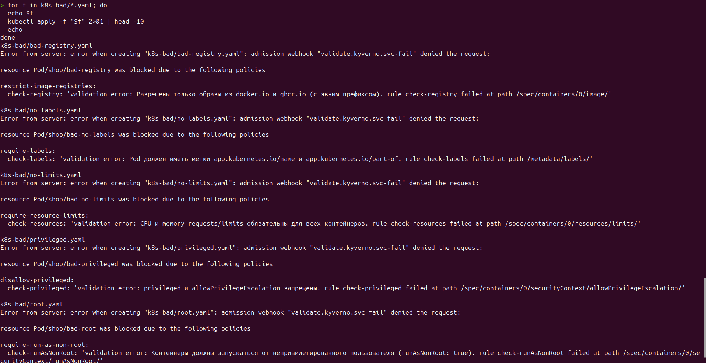

Придуманные заранее не правильные манифесты это круто, но я тут бы хотел забежать дальше и сразу сказать почему правила это круто и надо использовать.

У меня срабатывали правила и не давали мне установить 2 вещи: CloudNativePG  и Monitoring потому что они не подходили под правила.

PS. Поэтому мне пришлось добавить cnpg-system и monitoringю

PPS. monitoring пришлось поднимать потому что, я переезжал из minicube в kind (не поулчилось переиспользовать как в тз)

## ЧАСТЬ 2 (Чарт api и worker)

Оххх долго же я тут разбирался и тыкался: но в итоге написал:

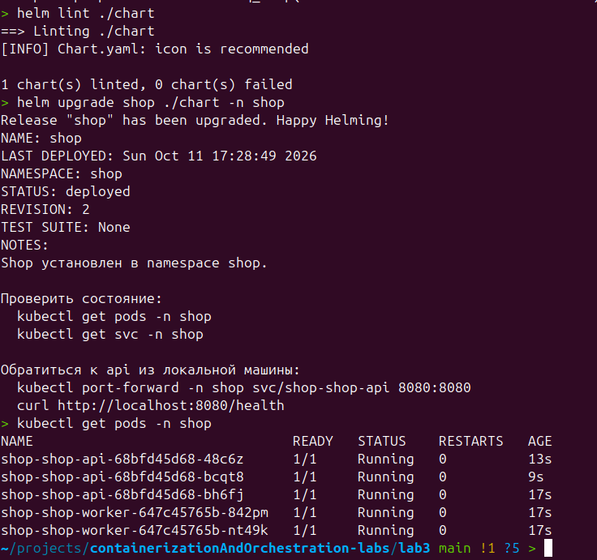

### reconciliation:

Далее удаляем под ручками и он возвращается

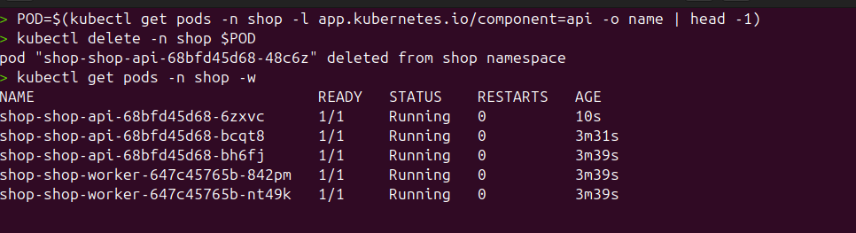

Поменял количество реплик:

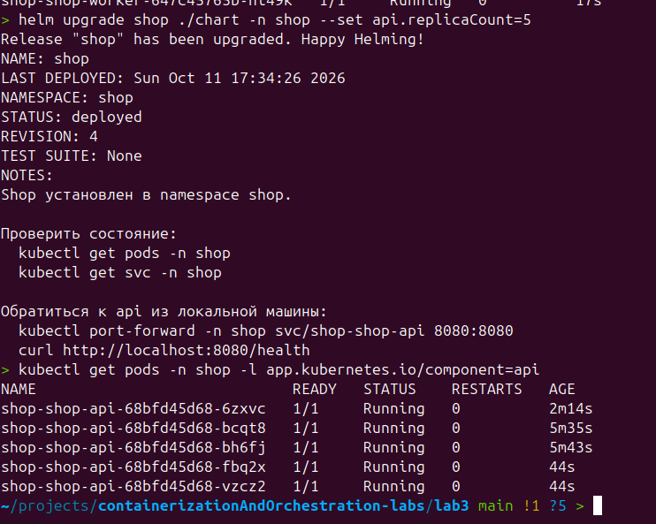

### rolling update:

Нагрузку запустил изнутри кластера через ClusterIP Service потому как прокидывание порта не было варианта.

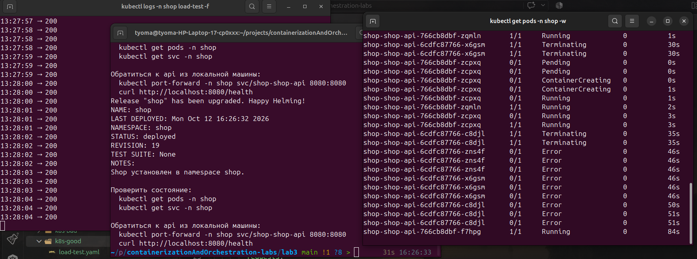

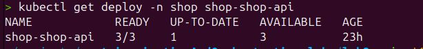

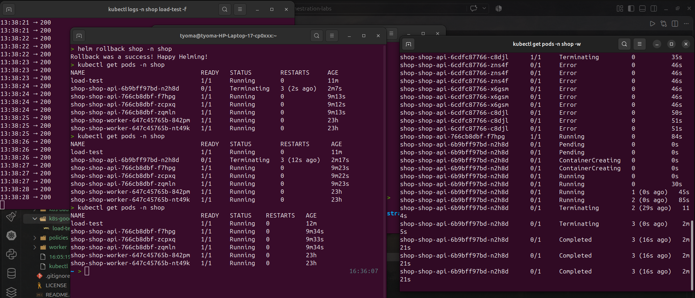

## ЧАСТЬ 3

Тут как я уже начал писать ранее  возникло куча проблем: 
1) не проходило по kyverno - пофиксил тем что в искючения добавил cnpg-system
2) джоба которая запускалась для установки была так же заблокированна из за того что отсутсвовала у неё лейбл - пофиксил добалением лейбла
3) DNS не резорвил постгрес потому как было не правильно имя - поменял с postrges на shop-shop-postgres-rw

Создал Cluster через CloudNativePG 

Проверил роботоспособность

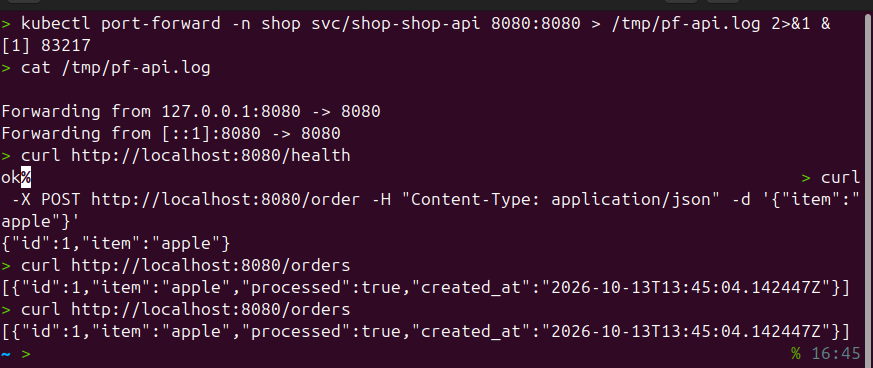

Разницу между CNPG и controle plane мне мложно описать, всё что я для себя понял что CP это часть кубика, а CNPG установочный плагин и следит он только за своим "внутренним убранством" 

## ЧАСТЬ 4 (КРАХ)

Для начался убедился в том, что мой test-load, который показывает мне 200 и в целом работоспособность сервиса, находится не на той же ноде что и CP

Тут у меня в целом всё в один скрин поместилось:

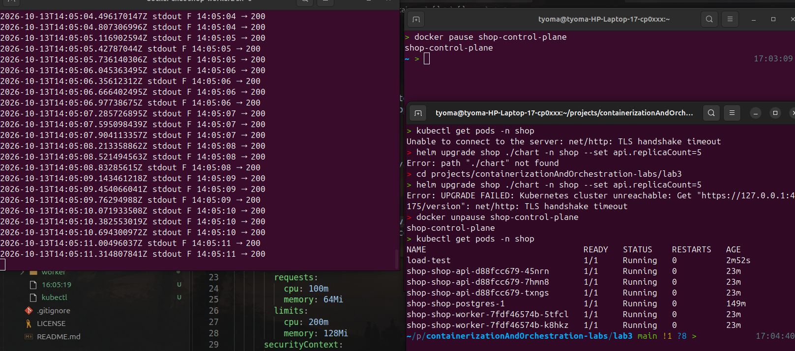

я честно всё вернул и всё заработало ))))
(я забыл скрин)

## ЧАСТЬ 5

Тк я делал эту лабу в kind пришлось пересоздавать api alert servicemonitorng и тд.

Было создано 3 алёрта:

 - ShopApiHighErrorRate - много ошибок приходит пользователям относительно. Сломал подключение api к БД.

 - ShopPostgresDown - упала бд (точнее под postgersql не рэди). Для вызова просто удалил под с бд

  - ShopApiDown - сервис не доступен. Вызвал перестроение порта сервиса.

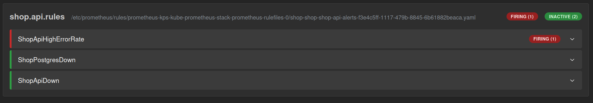

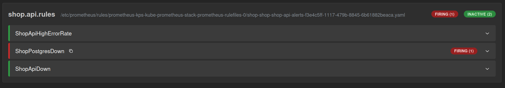

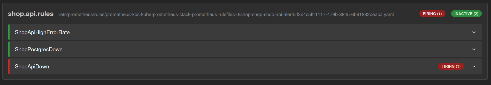
