# 4 лаба

Будут и мемы и впервые я решил делать отчёт паралельно лабе, а не постфактум. Посмотрим что будет)
А так же после крайней лекции по твоему совету для пущего понимания решил использовать lens, а точнее freelens.

## ЧАСТЬ 0 

    честно навайбкодил

## ЧАСТЬ 1 (podAntiAffinity vs topologySpreadConstraints)

Погнали решать что лучше для меня в данной ситуации

 - podAntiAffinity - жёстко разграничивает поды на ноде

На сколько я понял это было бы очень эффективно когда у тебя какой то высоконагруженный под постоянно жрёт ресурсы и ему нужна полная нода без соседей.

 - topologySpreadConstraints - пытается балансировать поды на нодах с запросанным нами гэпом в количестве подов

Мне побольше нравиться, пусть кубер балансирует сам.

Но меня больше смутило разница настройки whenUnsatisfiable

maxSkew — разница количества подов и нодов, а точнее разница между самой загруженной и свободной нодой.

есть 2 варианта:
 - DoNotSchedule - под не пройдёт по правилу(maxSkew) и упадёт в пэдинг
 - ScheduleAnyway - под обойдёт правило и установит поду на ноду

Я думаю проверить эффективность эмпирически 

Было бы всё так легко, что то за последнее время начал ложиться ноутбук(просто зависать) и я решил ограничить ноды в памяти из за чего не поднимался controle plane. long story short, пришлось пересоздать кластер, вновь добавить kyverno,monitoring и CNPG. И ВСЁ ПОЛУЧИЛОСЬ:

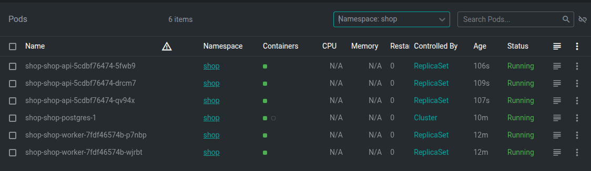

## ЧАСТЬ 2 

Написал batch-deployment и batch в value c ограничениями requests: 100m/128Mi, limits: 500m/512Mi.

Вот как я увидел всё в действии:

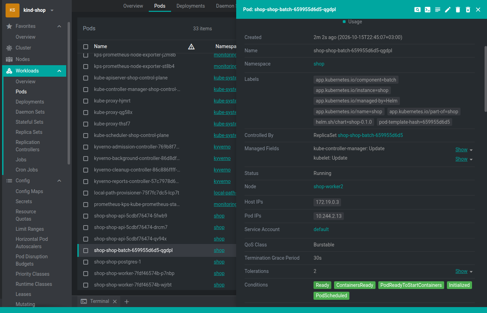

И то что он есть память:

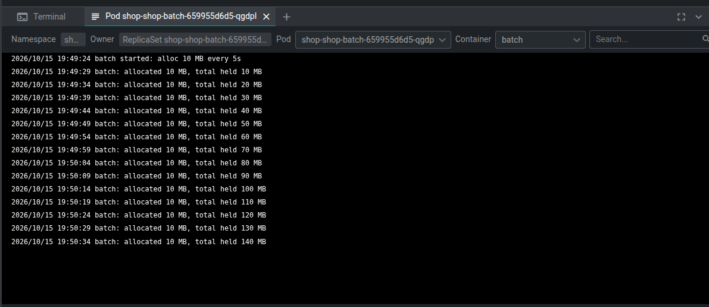

И как и что располоденно на двух нодах:

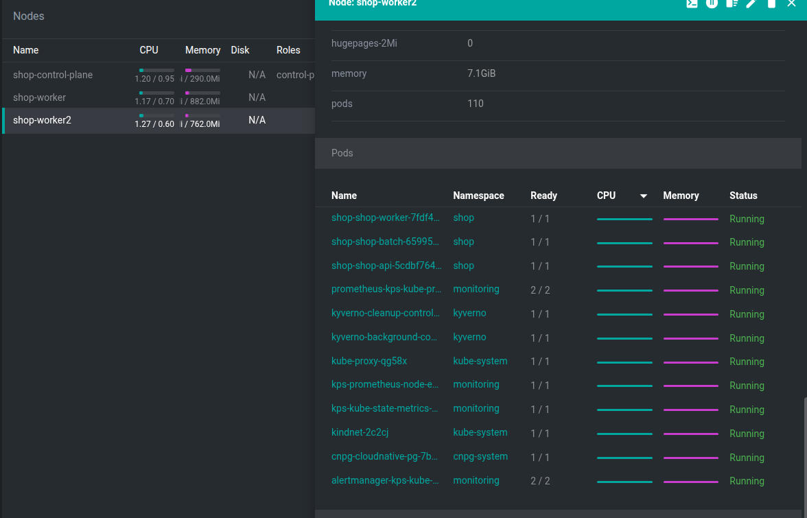

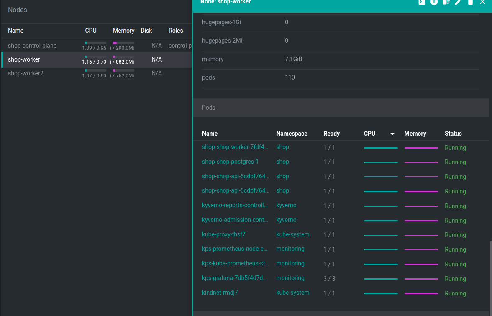

## ЧАСТЬ 3

Скачал k6 и запустил нагрузочный тест для сбора метрик. 

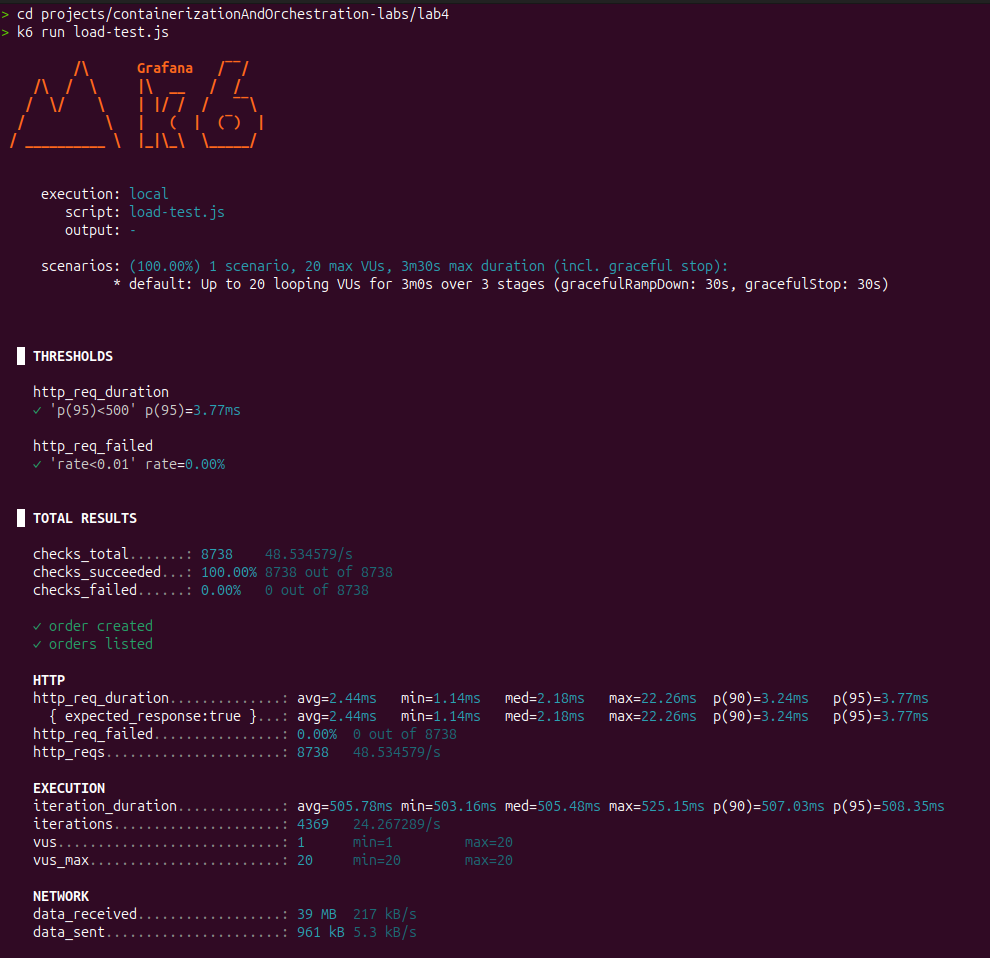

И после запустил krr, но есть проблема у меня упал batch, но после добавления ограничения для того чтобы не падало, но даже подождав какое то время всё равно мне krr ничего не выдал по batch

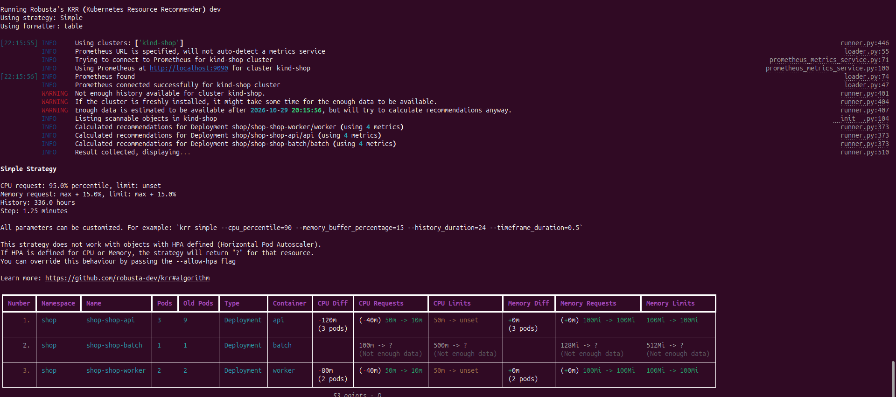

## ЧАСТЬ 4

Я чуть выше это показывал через Lens, но вот ещё один пруф.

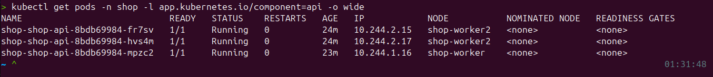

## ЧАСТЬ 5 Приоритеты и гарантии

Были написаны priorityclass и PodDisruptionBudget, не скажу что не было сложностей. По какой то причине был Burstable.

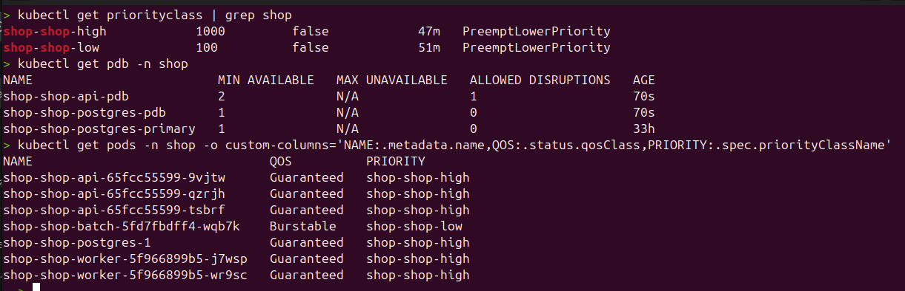

Разница Burstable и Guaranteed.

Это настройки которые показывают кубику приоритет порядок вытеснения при малом количестве ресурсов.

 - Guaranteed - высший приоритет, гарания ресурсов на ноде
 - Burstable - если ресуров перестанет хватать(в 6 части лицезреем), то тебя загасят)))

Есть ещё некоторый BestEffort, но я пока не понял для каких случаев это надо

## ЧАСТЬ 6 Pending и Preemption

Нужно продеманстрировать 2 ситуации когда у нас ноды встают в очередь не по фактц потребления а по лимитам и второй случай когда более приоритентая нода заменяет то что уже работает.

Маленькое отвлетнение на ПОГОРЕТЬ. После не единственного зависание и коротковременного отвисания ООМ firefox, причиной которых были то что batch грузил ядро на 100%. 

Для решения это сделал ENABLE_CPU_BURN=false и некоторые изменения в коде batch. Также 
ограничел kind в докере по памяти

Было предположения для того чтобы выподнить эту часть сделать так чтобы requests были большие а лимиты маленькие очень. НО такое не принял уже кубик 

Pending:

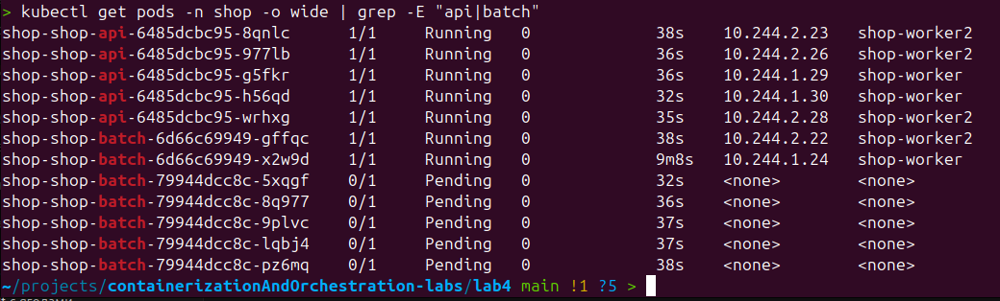

Preemption:

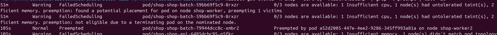

## ЧАСТЬ 7 Выселяемся

Разница ООМ и Eviction.

ООМ происходит когда превосходит свой лимит памяти, а Eviction происходит на ноде постепенно заканчивается память и когда пройден порог остатка памяти он начинает смотеть на QoS и по приоритету выселять под.

с последнего сообщения прошло 2 дня это самый сложный моментик был наверное за все лабы пока что просто из за моих технических характеристик ноута.

Был вариант уже перейти на k3s. И какими то другими способами это сделать.

У меня проблема в железе компа и при условии ограничения памяти на поду у меня при совсем маленьком выделении памяти не  поднимался controle plane или САМОЕ ЧТО ИНТЕРЕСНОЕ был случай тк у меня kind через docker у меня докер убивал под до того как происходило Eviction.

Если были способы как можно было это сдеалть по другому буду раз увидеть в комментариях к лабе

КАК Я СДЕЛАЛ(СЧИТЕРИЛ) В ИТОГЕ:

Пришлоть обратиться к api кубика чтобы он вызвал  Eviction, для этого времено пришлось отключить kyverno

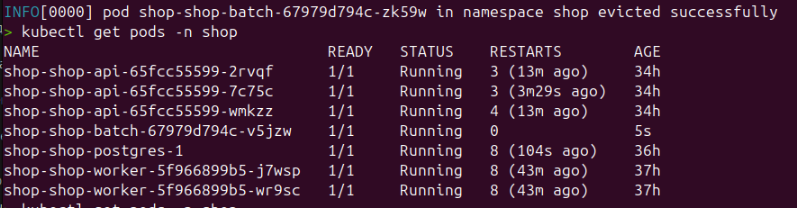

Если так нельзя и надо добиться всё же как то, то буду рад услышать как это следать на слабом железе(

## ЧАСТЬ 8 SLAAA

Развернул k6 с 20 пользователями. Справедливости ради с не такой большой нагрузке но всё же:

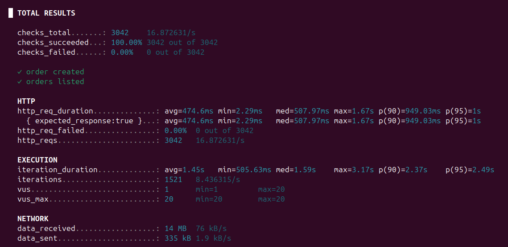

## ЧАСТЬ 9

Было создано 3 алёрта:

 - ShopApiHighErrorRate - много ошибок приходит пользователям относительно. Сломал подключение api к БД.

 - ShopPostgresDown - упала бд (точнее под postgersql не рэди). Для вызова просто удалил под с бд

  - ShopApiDown - сервис не доступен. Вызвал перестроение порта сервиса.

