# Интернетик

## ЧАСТЬ 0 CNI

Я выбрал cilium по причине котрая тянеться через все мои лабы, а именно производительность. И чатик подсказал что по скольку работает на уровне ядра и идеально подходит к этой лабе была выбрана это технология 

## ЧАСТЬ 1

    Смотрим что сеть по дефолту плоская:

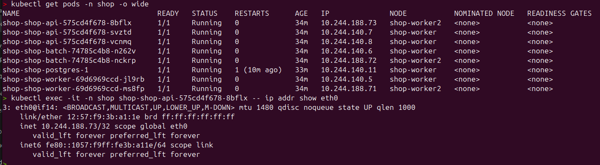

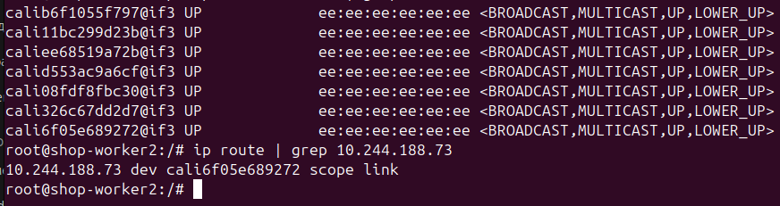

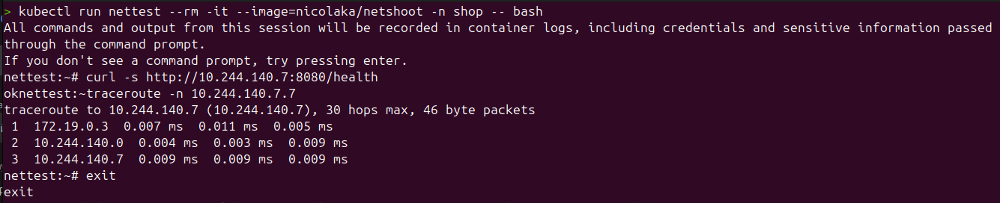

## ЧАСТЬ 2 ХАОС

Чем NodePort отличается от loadBalancer и Headless-сервиса:

NodePort (что хорошо передаёт название) - открывает порт на каждой ноде  

loadBalancer - надстройка которая получает публичный ip и распределяет трафик. Создаёт нодПорт и Кластер апи.

Headless-сервис - нет виртуального ip. Даёт клиенту прямой ip нодов, нету балансировки.

Написал 2 баша: первый убивает поды всё время, второй все время прокидывает запросы. 

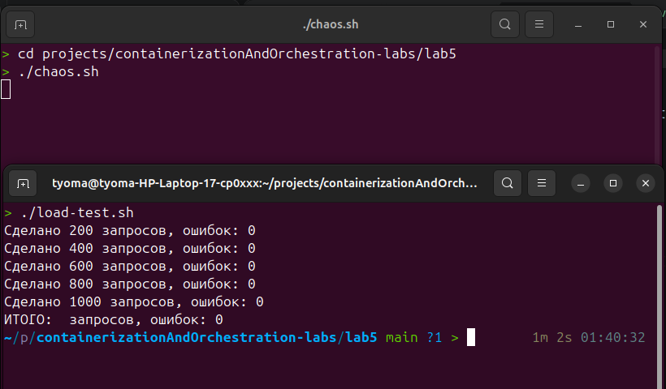

    А как это работает?
Клиет обращается к DNS, проспатривается EndpointSlice и отправляется запрос по ip которые там есть 

При удалении поды из EndpointSlice убирается его порт, а когда создаётся ip добавляется EndpointSlice.

## ЧАСТЬ 3 Матрица

- клиент -> api (можно, порт 8080);
- api -> PostgreSQL (можно, порт 5432);
- worker -> PostgreSQL (можно, порт 5432);

- DNS -> CoreDNS можно
НЕЛЬЗЯ: 
| Посторонний под -> postgres 
| Посторонний под -> api
| api -> worker`
| worker -> api` 
| Все поды -> Интернет (Egress) 

## ЧАСТЬ 4

Политика написана и применена:

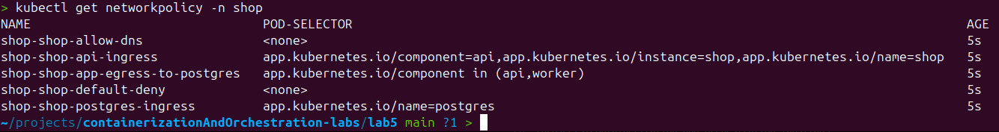

## ЧАСТЬ 5 Проверка на практике

Проверяем разрешённые:

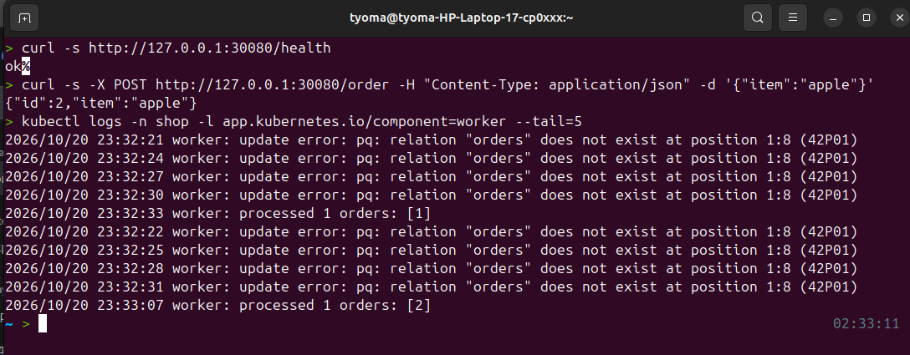

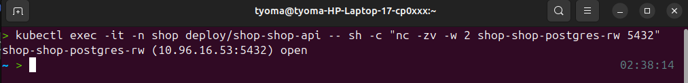

Проверяем запрещённые:

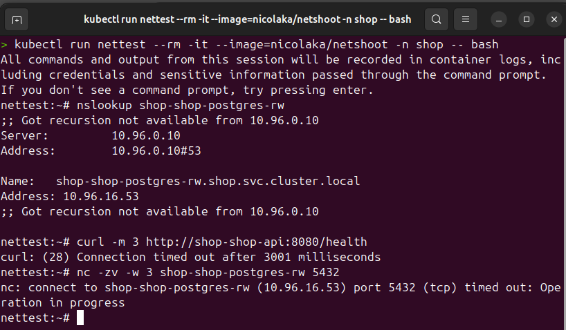

67

ВСЁ РАБОТАЕТ!!!

## ЧАСТЬ 6

Запускаем скрипт problems.sh

    Замечаем поломку запросом к бд:

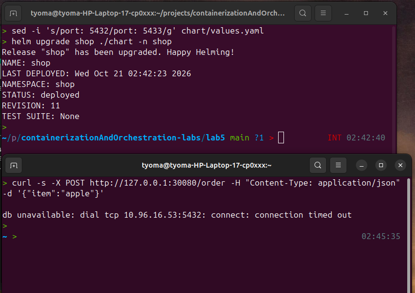

    Проверяем всё ли работает:

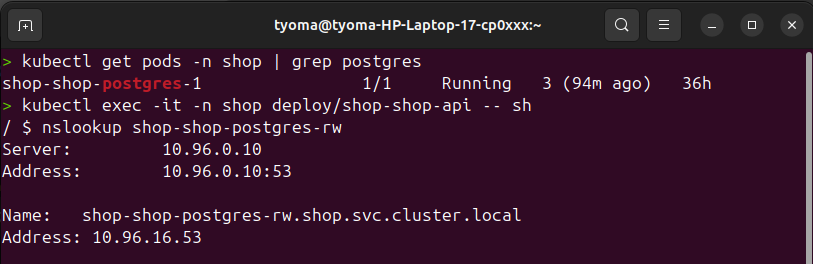

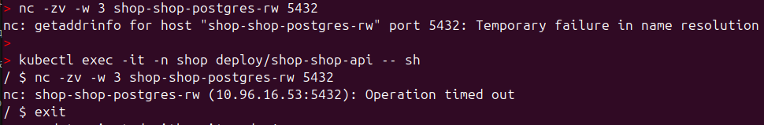

    Находим поломку:

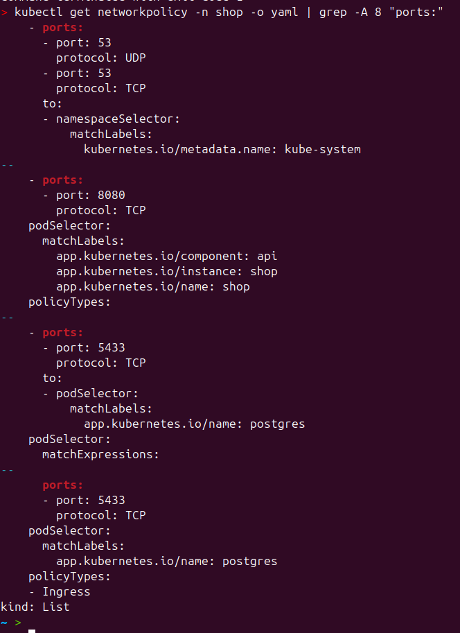

    Исправляем:

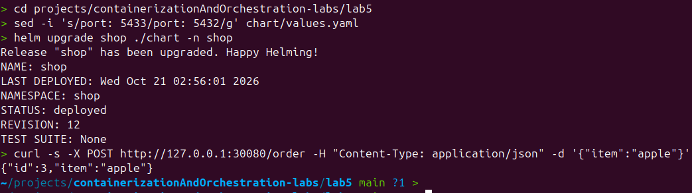

## ЧАСТЬ 7 Мониторинг

Было создано 3 алёрта:
 - ShopApiHighErrorRate — пользователи получают много ошибок (5xx). Сломал порт в NetworkPolicy от api к postgres (поменял 5432 на 5433), api перестал стучаться в базу и начал возвращать 503.
 - ShopApiDown — сервис полностью недоступен, Prometheus не может его проскрейпить. Сломал порт в NetworkPolicy от клиента к api (поменял 8080 на 8081), и api перестал принимать трафик снаружи.
 - ShopDNSResolutionFailing — CoreDNS не может разрешать имена (SERVFAIL/REFUSED). Сломал egress-правило к DNS (поменял 53 на 54), поды перестали находить друг друга по имени.

 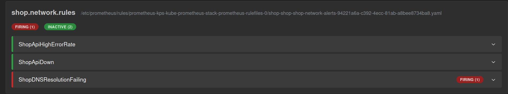