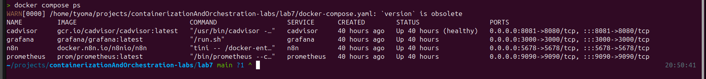
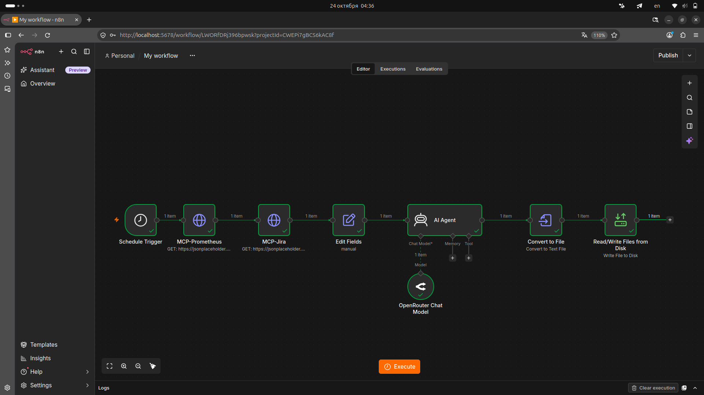
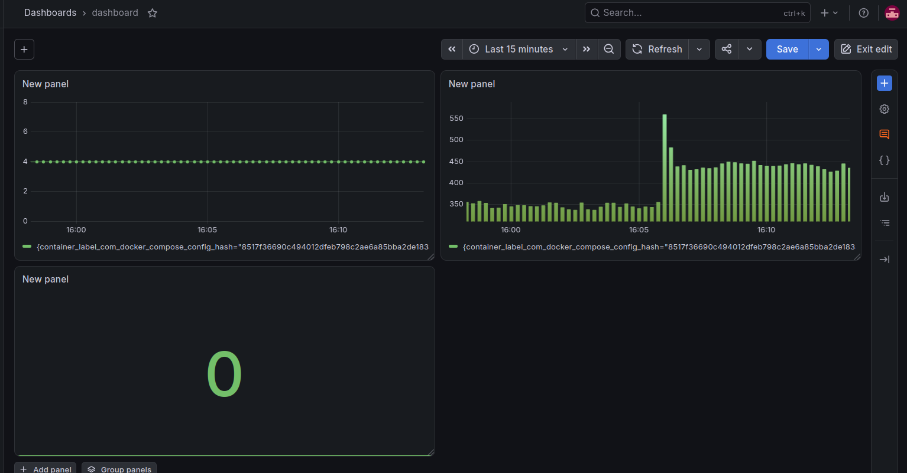

# B2B SAAAAAS

## ЧАСТЬ 1 КЕЙС

Честно не знаю есть ли этому альтернатива или как там работает в биг техах. После рассказа на лекции про дежурсво появилась идея как легче решать проблемы дежурных devops инженеров.

Нейронка ходит в метрики каждый понедельник в 10 утра и смотрит какие проблемы и алёрты были за неделю, также смотрит jira и какие тикеты были решены а какие нет. И выкатывает отчёт и список того что нужно сделать и какие проблемы актуальны. 

## ЧАСТЬ 2 АРХИТЕКТУРА

Если коротко ТО: Триггер -> Сбор данных (MCP) -> Нормализация -> AI-анализ -> Сохранение результата в мдешник.

Триггер: Запускает весь процесс по расписанию cron 0 10 * * 1. Срабатывает сам, избавляя инженера от необходимости помнить о запуске.

Сбор данных : Обращается к внешним системам через MCP-серверы к Prometheus и Jira. Забирает сырые метрики за неделю и список незакрытых инцидентов.

Нормализация: Объединяет разнородные ответы от двух систем в единый структурированный текст. Приводит данные к виду, который сможет легко прочитать ИИ.

AI-анализ: Передает подготовленный текст AI-агенту. Агент анализирует данные и генерирует связный md отчет по заданному промту.

Сохранение результата: Преобразует сгенерированный ИИ текст в бинарный файл и записывает его на диск. Обеспечивает готовый артефакт, который дежурный может сразу открыть и прочитать.

## ЧАСТЬ 3

Для начала скачать образ n8n, авторизировался и сделал цепочку. 

 

Были проблемы с сохранением данных в разных форматах. 

И результат можно посмотреть в handoff-notes.md

## ЧАСТЬ 4 Мониторинг

Было сделано 3 метрики

 - Панель 1 - сколько времени прошло с последней активности контейнера
 - Панель 2 - показывается потребление ОЗУ
 - Панель 3 -  показывается количество перезапусков контейнера за час

